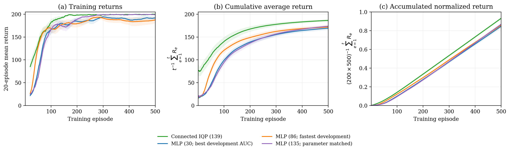

# IQP policy experiments

Research code, notebooks, saved results, and reproducibility material for
**Trainability–Simulability Tradeoff in Parameterized IQP-based Reinforcement Learning Policies**
by André Sequeira.

This is the companion experiment archive, **not the main QASP software repository**.
The maintained software is [INESCTEC/qasp](https://github.com/INESCTEC/qasp).
The archive preserves the experiment implementations and historical results,
including exploratory and negative results, rather than silently replacing them
with the latest QASP implementation.

## Start here

| Goal | Entry point |
|---|---|
| Understand which experiments support the manuscript | [Experiment catalogue](docs/EXPERIMENTS.md) |
| Verify that the downloaded archive is intact | `python tools/verify_archive.py` |
| Redraw connected-IQP/MLP learning curves without training | `python tools/replot_connected.py` |
| Inspect the final 20-seed comparison | [Saved test analysis](results/connected_iqp_mlp_study/test_analysis.json) |
| Inspect initialization sensitivity | [Uniform-initialization results](results/connected_iqp_uniform_initialization/) |
| Reproduce experiments or inspect historical assumptions | [Reproduction guide](docs/REPRODUCIBILITY.md) |
| See what was absent from the public QASP repository | [Upstream audit](docs/UPSTREAM_AUDIT.md) |



## What is included?

- IQP initialization-variance experiments: path/ring architectures, majority
  Fourier checks, repeated circuits, random cubic graphs, and three-body extensions.
- CartPole comparisons between majority, parity, local readouts, and classical MLPs.
- Gradient-sector diagnostics with seed-level data and checkpoints.
- The connected 21-qubit majority policy and the tuned MLP size study.
- The uniform-initialization follow-up and analytical runtime audits.
- Earlier architecture searches, disconnected controls, finite-shot SPSA runs,
  and additional circuit variants, explicitly catalogued as historical or exploratory.
- A compact historical QASP source snapshot in `qasp/`, needed by these experiment
  implementations. It is not a claim that current upstream QASP reproduces old
  trajectories bit for bit.

Saved arrays, tables, model checkpoints, configurations, and software metadata
are included where they were available locally. **Not every historical notebook
has a separately audited seed-level dataset.** Missing provenance and incomplete
reproduction coverage are described in the reproduction guide.

## Quick start: inspect results, no quantum training required

```bash
git clone https://github.com/andre-sequeira10/iqp-policy-experiments.git
cd iqp-policy-experiments
python3 -m venv .venv
source .venv/bin/activate  # Windows: .venv\Scripts\activate
python -m pip install -r requirements-analysis.txt
python tools/verify_archive.py
python tools/replot_connected.py --output generated/connected
```

The plotting command reads saved returns, verifies their AUCs against the saved
records, and writes new PNG/PDF figures and a summary JSON under `generated/`.
It does not import QASP, load checkpoints, retrain models, or overwrite archived
results. The full archive-integrity check uses only the Python standard library.

## Full experiment environment

Use a **separate working clone** before retraining: historical scripts and notebooks
write to their `results/` or `tests/results/` directories, and some resume existing
runs rather than replacing them.

Python 3.10 was used for the historical runs. A recorded package-version reference
is provided in [requirements-historical.txt](requirements-historical.txt); it is
not a fully resolved lockfile for every study or operating system.

```bash
python -m pip install -r requirements-historical.txt -e . jupyterlab nbformat nbclient networkx pyarrow joblib
python connected_iqp_mlp_study.py status --phase test
jupyter lab
```

The editable installation installs the bundled historical `qasp` package. Do not
also install a different QASP version in that environment. Launch notebooks from
this repository; the added first cell sets the repository root consistently.
Read each notebook's settings before executing it. Full experiments can be costly;
the statevector studies scale exponentially with qubit count.

## How to interpret the results

- Variance theorems concern specified initialization ensembles at a fixed
  observation. They are not guarantees of end-to-end RL convergence.
- Exponential **exact** Fourier support is not a proof of classical hardness.
- The connected 21-qubit model is efficiently classically contractible. Its
  learning experiment is a quantum-inspired model comparison, not quantum advantage.
- Under its original initialization, connected IQP has mean normalized AUC
  **0.9319**, versus **0.8680** for the 135-parameter MLP. With uniform biases and
  interaction angles, the IQP follow-up has AUC **0.7615**. The initialization
  dependence is part of the result, not a discarded run.
- Episode-based AUC is not identical to environment-step efficiency or wall-clock
  efficiency. Consult the protocols before combining results across studies.
- Disconnected models and connected-model finite-shot studies remain in this
  archive for transparency; they are not included in the final connected analytical
  comparison in the manuscript.

## Repository layout

```text
qasp/                  Historical software snapshot used by the experiments
tests/*.ipynb          QASP-side experiment notebooks
tests/results/         Their saved data, figures, protocols and checkpoints
*.py, *.ipynb          Connected-model studies, search, analysis and export tools
results/               Saved connected-model/search/SPSA/runtime studies
tools/                 Archive verification and no-training result reproduction
docs/                  Study catalogue, provenance and reproduction guidance
REPOSITORY_PROVENANCE.json  Source and publication hashes; portability changes
MANIFEST_SHA256.json    Authoritative integrity inventory for this release
```

## Provenance and scope

The public QASP tree was inspected at commit
[`4aeec0ba2714676b86abe499c39acdb9b910a6de`](https://github.com/INESCTEC/qasp/tree/4aeec0ba2714676b86abe499c39acdb9b910a6de).
It includes related simulator examples and unit tests, but not the dedicated
paper experiment notebooks and complete studies collected here.

The bundled QASP snapshot accompanies the manuscript's review archive; its
recorded checkout HEAD is `8c9ccace59bfacfe4bc2df7155346aebe4506a2a`.
That checkout contained local changes, so the commit alone does not specify every
historical run. Per-file hashes and per-run metadata supply the finer provenance.
Author-machine paths were normalized and notebook root setup was added without
changing model definitions or experimental hyperparameters. Nested historical
manifests may retain hashes of the original, pre-portability files; use the root
manifest for this release.

## Checkpoint safety

`.pt` files are historical PyTorch checkpoints and may contain pickle data.
Only load trusted checkpoints. The archive verifier and plotting quick start do
not deserialize them. Do not treat a passing checksum as a security guarantee.

## Citation and licensing

Please cite the manuscript and QASP when using these experiments. A publication
DOI has not been supplied, so none is invented here. Record the repository commit
used in any reproduction.

The bundled QASP code retains its upstream MIT notice in
[LICENSE-QASP](LICENSE-QASP). A separate license for the experiment-specific
material has not yet been selected; no additional reuse permission is implied.

For questions or reproducibility issues, open an issue in this repository and
include the experiment name, commit, software versions, and the failing command.
